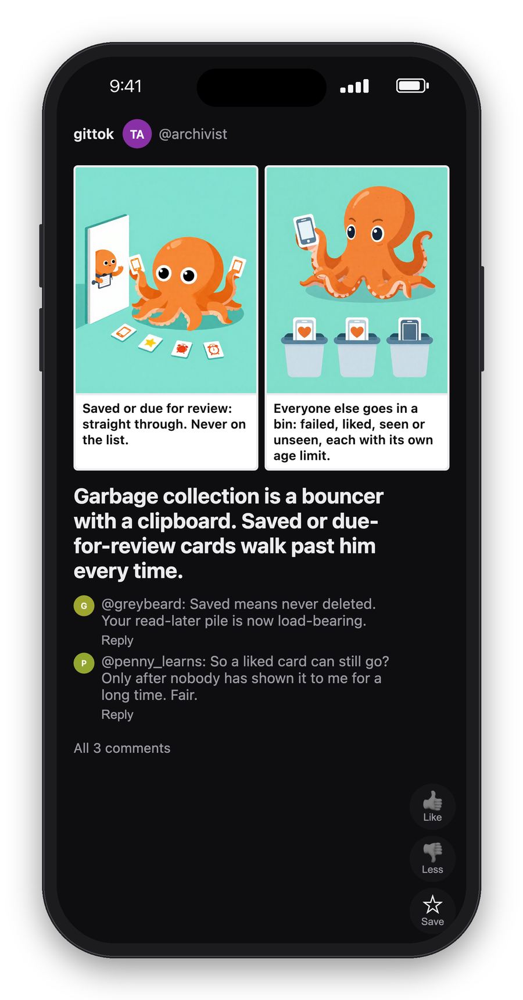

# GitTok

**Doomscrolling Your Code**

GitTok turns your git repos into a TikTok-style feed. Swipe through short posts about the code you work in every day: the function everything depends on, the commit that got reverted twice, the TODO that has been waiting for six years, the two files that always change together.

Some posts teach. Some are quizzes: spot the bug, guess who wrote it, guess when. Some are memes, comics, tier lists, group chats and horoscopes about your own code, with a cast of regulars arguing in the comments. Swipe up for the next post. Swipe sideways to go deeper, from the hook down to the real code and the real diff.

It is a fast way to learn a codebase you just joined, and a surprisingly fun way to rediscover one you thought you knew.

- **Every post is checked against git.** Your coding agent (for example Claude Code) writes the posts, and GitTok verifies each cited commit, file and line before a post reaches your feed.
- **It learns what you like.** What you read, like and skip shapes what comes next. You can also just say it: "less memes, more of the sync engine."
- **It helps things stick.** A quiz you got wrong comes back a day later, then after three days, then a week, until you have it.
- **It is private.** Everything runs on your own machine. GitTok never writes to your repos and calls no model API of its own.

<!-- screenshot -->
<p align="center"></p>

## Requirements

- macOS. Other platforms are not supported yet.
- [uv](https://docs.astral.sh/uv/). uv downloads Python 3.13 for you.
- git.
- A coding agent. GitTok is made for and tested with [Claude Code](https://claude.com/claude-code), and this page uses it. The agent writes the posts, and you manage GitTok by asking it. GitTok does not call a model API itself.

## Install

```bash
uv tool install 'gittok[images]'
cd ~/gittok               # a new or empty directory of your choice (make it first)
gittok init .
claude
```

The `images` extra adds mflux, which draws the illustration and comic posts. It works on Apple silicon only. It is a large download: about 1 GB now, and a model later ([docs/install.md](docs/install.md), "Illustration renderer", has the one-time model setup). On a Mac that is not Apple silicon the extra adds nothing.

Meme posts need their template images once: Claude offers to download them (about 20 MB), or run `gittok memes --prefetch`. GitTok draws the memes itself; nothing else to install.

`gittok init <dir>` makes a **GitTok directory**. It holds everything GitTok needs and everything GitTok makes:

- `AGENTS.md`: it tells your coding agent what the directory is and how to work with GitTok.
- For Claude Code: `.mcp.json` (it starts the GitTok MCP server when a session starts in this directory), `.claude/` (the skills and agents that make posts, profile a repo, and manage GitTok, and the session hooks that keep the feed full), and a `CLAUDE.md` that points to `AGENTS.md`.
- Your repo list, settings, posts and logs (see "Where your files live").

The first time you start `claude` in the directory, Claude Code asks you to approve the MCP server `gittok`. Approve it.

**GitTok runs only while a Claude Code session is open in that directory.** The session starts the MCP server (Claude talks to it over stdio), and the MCP server starts the feed server on port 7313. When the session ends, the feed stops. Nothing is installed outside the directory, and nothing starts by itself.


## Use it

Start Claude Code in your GitTok directory (`cd ~/gittok`, then `claude`). You manage GitTok by asking Claude in plain words. Claude Code asks for your permission before it runs a GitTok tool.

1. **Add a repo.** Give a directory or a git URL:
   - "Add the repo at ~/src/myapp to GitTok."
   - "Add https://example.com/org/storefront.git to GitTok."

   GitTok reads a directory in place and never changes it. It clones a URL into `repos/` of the GitTok directory and fetches it before each analysis.

   Claude then profiles the repo: it reads the repo and writes the rules that find the code worth teaching. This takes a few minutes and some of your model quota. Claude may ask your permission to run a code analyzer, and it may offer to download grammars so that GitTok reads the code structure better. After that, Claude makes the first posts. You do not have to ask for either step.
2. **Open the feed** on this computer: <http://127.0.0.1:7313>. It answers while the session is open.
3. **Pair your phone.** "Pair my phone." Claude opens a page with a QR code. Scan it with the phone camera. Both devices must be on the same network. You do this once for each device. For an app on the home screen, tap "Pair with a code" in the app instead, and tell Claude the code it shows.

Later:

- **Steer the feed.** "Less memes." "More of the sync engine this week." "What have you learned about me?"
- **Remove a repo.** "Remove myapp from GitTok." GitTok deletes a clone that it made itself. It never touches a directory of your own. The posts made from the repo are removed too.
- **More posts.** The feed refills by itself while a Claude Code session is open in the GitTok directory: when the unread posts run low, or when you reach the end of the feed, the session makes more. With no session open, nothing makes posts. You can also ask at any time: "make more posts" (or `/gittok-generate`). [docs/scheduling.md](docs/scheduling.md) has the exact rules.

### Phone access and your network

GitTok is made for a phone, so the feed server serves the feed to your local network while a session is open. Know what that means:

- The feed goes over plain HTTP, not HTTPS.
- Any device on the same network can reach the port. It gets nothing until it opens the pairing link or QR code once, or until you tell Claude the code that it shows. Claude talks to GitTok over stdio; the MCP server is not on the network.
- Someone who can watch traffic on that network could read the pairing token and the posts. Posts hold excerpts of your code.
- So use it on a network you trust, such as your home network. Take care on shared or public Wi-Fi.
- To turn it off, say "turn off phone access", or set `server.lan: false` in `local/settings.yaml` of the GitTok directory. The server then answers this computer only.

[docs/install.md](docs/install.md) has an optional HTTPS recipe. [SECURITY.md](SECURITY.md) says what GitTok protects and what it does not.

### Commands

Each step also has a command, for example `gittok repos add <name> <path-or-url>`, `gittok repos remove <name>` and `gittok structure --prefetch`. `gittok --help` lists them. Run them inside the GitTok directory. Outside one, they stop with an error.

## Where your files live

All your files are in the GitTok directory that you made:

- `local/`: your repo list, repo profiles and settings ([docs/config.md](docs/config.md)).
- `data/`: the database, post images and logs.
- `repos/`: the clones of repos that you added by URL.

You can move or copy the directory. You can also make more than one, for example one for work and one for your own projects ([docs/install.md](docs/install.md)).

## Upgrade and uninstall

```bash
uv tool upgrade gittok
```

uv records the `images` extra when you install with it, and the upgrade uses that record.

Then start Claude Code in the GitTok directory and say "update this GitTok directory". Or run `gittok update` in the directory. It writes the new skills, agents and settings. It does not touch `local/`, `data/` or `repos/`. If you edited one of its files, it keeps your copy as `<name>.bak`.

To remove GitTok, delete the GitTok directory and run:

```bash
uv tool uninstall gittok
```

A repo that you added by path is your own directory. GitTok never touches it.

## Documentation

The docs and the tools call a post a *card*.

- [docs/install.md](docs/install.md): the GitTok directory, upgrade and uninstall, session hooks, renderers, HTTPS on a LAN.
- [docs/config.md](docs/config.md): every config file and key.
- [docs/formats.md](docs/formats.md): post formats and visual kinds.
- [docs/learning.md](docs/learning.md): events, reward, ranking, repo profiles, garbage collection.
- [docs/social.md](docs/social.md): stories, notifications, offline mode, LAN access.
- [docs/api.md](docs/api.md): the feed HTTP API.
- [docs/scheduling.md](docs/scheduling.md): how to keep the feed full.
- [SPEC.md](SPEC.md): the design. What a post is, and how the parts fit.
- [DEV.md](DEV.md): how to develop and test GitTok, and how to release it.
- [CHANGELOG.md](CHANGELOG.md), [SECURITY.md](SECURITY.md), [LICENSE](LICENSE) (Apache 2.0).
