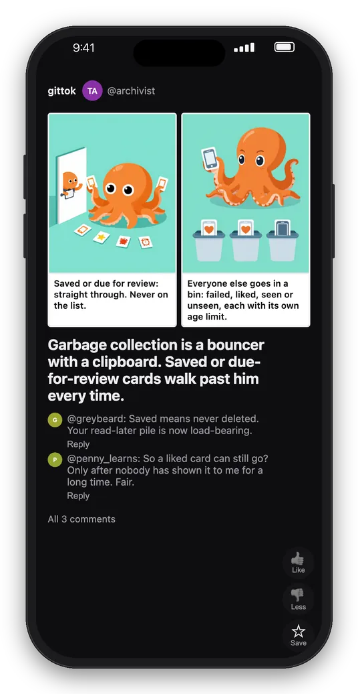

# GitTok

**Doomscrolling Your Code**

GitTok turns your git repos into a TikTok-style feed. Swipe through short posts about the code you work in every day: the function everything depends on, the commit that got reverted twice, the TODO that has been waiting for six years, the two files that always change together.

Some posts teach. Some are quizzes: spot the bug, guess who wrote it, guess when. Some are memes, comics, tier lists, group chats and horoscopes about your own code, with a cast of regulars arguing in the comments. Swipe up for the next post. Swipe sideways to go deeper, from the hook down to the real code and the real diff.

- **Every post is checked against git.** Your coding agent (Claude Code or Codex) writes the posts, and GitTok verifies each cited commit, file and line before a post reaches your feed.
- **It learns what you like.** What you read, like and skip shapes the posts that get made next. You can also just say it: "less memes, more of the sync engine."
- **It helps things stick.** A quiz you got wrong comes back a day later, then after three days, then a week, until you have it.
- **It is private.** Everything runs on your own machine. GitTok never writes to your repos and calls no model API of its own.

<p align="center"></p>

## Quick start

macOS, [uv](https://docs.astral.sh/uv/), git and [Claude Code](https://claude.com/claude-code) or [Codex](https://developers.openai.com/codex/):

```bash
uv tool install --python 3.13 gittok    # Claude Code: see "Better images" below
mkdir ~/gittok && cd ~/gittok
gittok init .
claude
```

> **Better images in Claude Code.** Claude Code has no image tool, so without extras Claude draws the illustration and comic posts as simple flat SVG pictures. On Apple silicon, install with the `images` extra for real illustrations: `uv tool install --python 3.13 'gittok[images]'`. It adds [mflux](https://github.com/filipstrand/mflux) (about 1 GB) and a 6 GB model that GitTok downloads by itself. Codex uses its own image tool by default. To use mflux in Codex instead, install with the extra and ask Codex: "Use local image generation." Or set it yourself in `local/settings.yaml` of your GitTok directory:
>
> ```yaml
> render:
>   image_backend: local
> ```

Approve the `gittok` MCP server, then ask Claude: "Add the repo at ~/src/myapp to GitTok." When the first posts are made, open the feed address that Claude gives you on your phone (or ask "what is the feed address?"), tap "Pair with a code", tell Claude the code, and start scrolling.

For Codex, run `codex` in the same directory, trust the project configuration and review `/hooks`. Ask Codex to add a repo, or use `$gittok-generate` to make cards. Both agents share the same workflows and MCP server.

## Documentation

**<https://nvoxland.github.io/gittok/>**

- [Install](https://nvoxland.github.io/gittok/getting-started/install/) and [your first feed](https://nvoxland.github.io/gittok/getting-started/first-feed/)
- [Guide](https://nvoxland.github.io/gittok/guide/repos/): repos, cards, steering, how the feed learns, privacy, configuration, the feed API
- [Blog](https://nvoxland.github.io/gittok/blog/): what is new in each release
